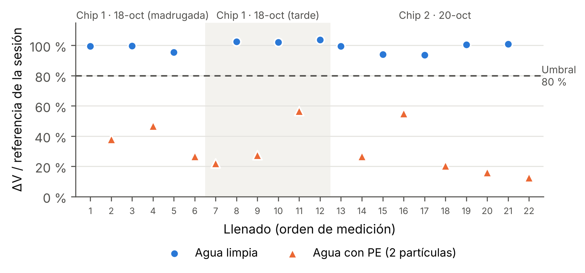
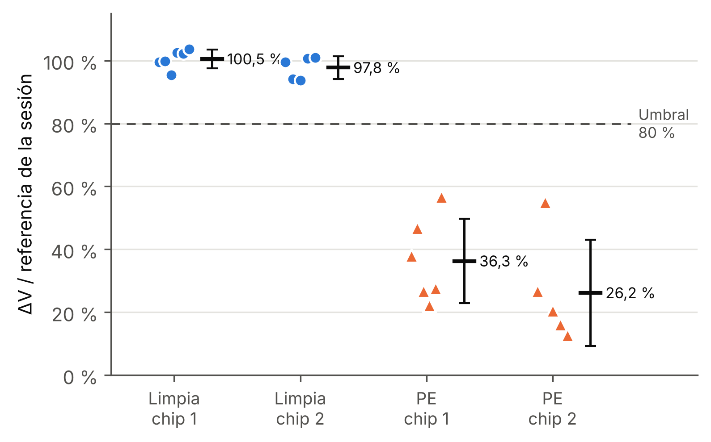
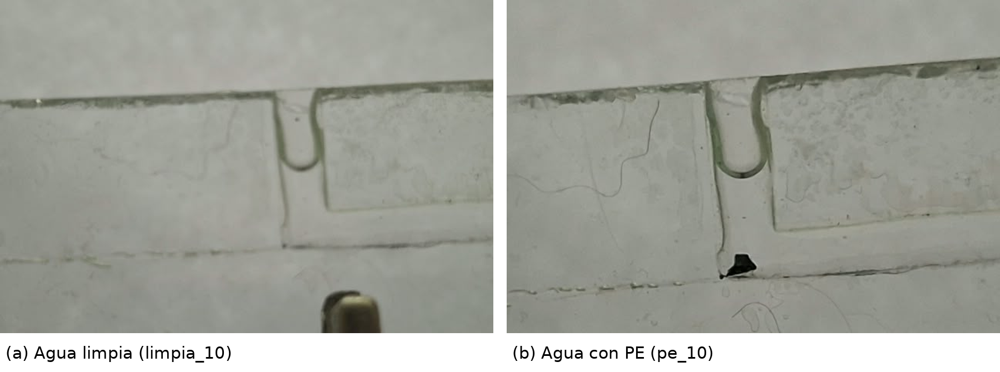
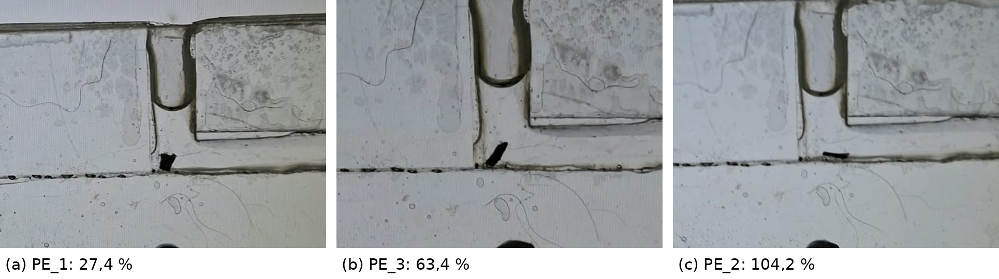

# Detector optoelectrónico de partículas compatibles con microplásticos (PE) en agua

Firmware, datos y análisis del prototipo desarrollado como Proyecto de Grado II de Ingeniería
Electrónica, Universidad Santo Tomás, 2026-2.

El prototipo hace pasar la luz de un LED infrarrojo (940 nm) a través de un chip con un canal en L
lleno con la muestra de agua, y mide con un fotodetector OPT101 cuánta luz llega al otro lado.
Si hay una partícula de polietileno (PE) en la zona de medición, la luz que llega baja. Una
Raspberry Pi Pico 2 W controla el LED, lee la señal y entrega los resultados por USB.

**Resultado principal:** en 22 llenados con dos chips distintos, el prototipo distinguió el agua
limpia del agua con partículas de PE en todos los casos (22 de 22), con una caída media de la
señal del 68 % y una diferencia estadísticamente significativa (prueba *t* de Welch,
p = 1,8 × 10⁻⁸).

---

## Contenido

1. [Resultados](#resultados)
2. [Cómo funciona la medición](#cómo-funciona-la-medición)
3. [Hardware](#hardware)
4. [Firmware](#firmware)
5. [Cómo usarlo](#cómo-usarlo)
6. [Medir desde el celular (WiFi)](#medir-desde-el-celular-wifi)
7. [Pruebas del código en el PC](#pruebas-del-código-en-el-pc)
8. [Evidencias y datos](#evidencias-y-datos)
9. [Alcance y limitaciones](#alcance-y-limitaciones)
10. [Estructura del repositorio](#estructura-del-repositorio)
11. [Equipo](#equipo)

---

## Resultados

### Campaña de validación: agua limpia frente a agua con PE

Tres sesiones (18 y 20 de octubre de 2026), dos chips, orden alternado. Cada llenado aporta un
solo valor: su ΔV expresado como porcentaje de la referencia de agua limpia de la sesión
(*T*<sub>rel</sub>). Criterio de detección, definido antes de medir: **PE probable si
*T*<sub>rel</sub> < 80 %**.



| Grupo | Llenados | *T*<sub>rel</sub> media | Desviación estándar | Rango |
|---|---|---|---|---|
| Agua limpia | 11 | 99,3 % | 3,4 % | 93,7 – 103,7 % |
| Agua con 2 partículas de PE (2 × 1 mm cada una) | 11 | 31,7 % | 15,2 % | 12,6 – 56,7 % |



**Prueba *t* de Student en su versión de Welch** (no supone varianzas iguales), con un valor por
llenado:

| Conjunto | *t* | g. l. | p | Diferencia de medias | IC 95 % de la diferencia |
|---|---|---|---|---|---|
| Chip 1 (6 + 6) | 11,5 | 5,5 | 4,9 × 10⁻⁵ | 64,2 puntos | 50,2 a 78,3 |
| Chip 2 (5 + 5) | 9,3 | 4,4 | 5,0 × 10⁻⁴ | 71,6 puntos | 50,8 a 92,4 |
| **Total (11 + 11)** | **14,4** | **11,0** | **1,8 × 10⁻⁸** | **67,6 puntos** | **57,2 a 78,0** |

Comprobación no paramétrica (Mann-Whitney): p = 8,2 × 10⁻⁵.

**Matriz de confusión** (umbral del 80 %; la condición real se verificó con una foto a contraluz
de cada llenado):

| Condición real \ Prototipo | PE probable | Sin partículas |
|---|---|---|
| Con PE (11) | **11** | 0 |
| Agua limpia (11) | 0 | **11** |

Sensibilidad y especificidad observadas: 100 %. Con 11 casos por grupo, el intervalo de confianza
del 95 % (Clopper-Pearson) de cada una va del 71,5 % al 100 %.



### Prueba complementaria: una sola partícula (22 de octubre)

| Llenado | Partícula | *T*<sub>rel</sub> | Resultado |
|---|---|---|---|
| PE_1 | 3 × 2 mm, de frente al haz | 27,4 % | Detectada |
| PE_2 | 3 × 2 mm, de canto y corrida de la esquina | 104,2 % | No detectada |
| PE_3 | 3 × 2 mm, en diagonal | 63,4 % | Detectada |
| PE_4 | 1 × 1 mm (exploratorio) | 102,1 % | No detectada |

La caída de señal corresponde a la sombra que la partícula proyecta sobre el haz: depende de que
la partícula quede dentro del haz y de cómo quede orientada.



### Caracterización del instrumento

| Magnitud | Valor |
|---|---|
| Ruido del ADC (entrada a GND) | σ ≈ 2,1 cuentas (1,7 mV) |
| Fondo con el LED apagado | ≈ 22 cuentas con la cámara tapada |
| Ruido por lectura con el LED | ≈ 1,1 % de la señal (viene del LED, no del ADC) |
| Variación entre las 10 repeticiones de un llenado | < 0,34 % |
| Cambio de la referencia durante una sesión (cierre vs. inicio) | +0,23 % y +0,78 % |
| Variación entre llenados de agua limpia | 3,4 % |
| Deriva térmica del LED al encender | exponencial, τ ≈ 69 s → calentamiento de 180 s |
| Saturación del OPT101 a 3,3 V | ≈ 2,52 V ≈ 3128 cuentas (umbral del firmware: 3050) |

Restar la medición con el LED apagado elimina la luz ambiente: con el fondo subiendo de 22 a
62 cuentas, el agua limpia siguió midiendo alrededor del 100 % de la referencia.

---

## Cómo funciona la medición

Cada **repetición** (≈ 2,1 s):

1. LED apagado → 1000 lecturas en 1 s → promedio `mu_dark` (fondo).
2. LED encendido → 1000 lecturas en 1 s → promedio `mu_light`.
3. Señal útil: **ΔV = mu_light − mu_dark**.

Cada **llenado** (comando `MEASURE`, ≈ 3 min 20 s): 180 s de calentamiento del LED sin guardar
datos, 10 repeticiones (una fila CSV cada una) y una fila `SUMMARY` con el promedio de las 10.

Cada **sesión**: verificación inicial con agua limpia (`MONITOR 20`), que da la referencia
ΔV<sub>ref</sub>; los llenados en orden alternado (limpia, PE, limpia, …); y un `MONITOR` de
cierre. En el análisis, *T*<sub>rel</sub> = ΔV / ΔV<sub>ref</sub> × 100 %.

Protocolo completo: [`docs/protocolo_medicion.md`](docs/protocolo_medicion.md).
Significado de cada columna: [`docs/guia_de_datos.md`](docs/guia_de_datos.md).

---

## Hardware

| Componente | Conexión |
|---|---|
| Raspberry Pi Pico 2 W (RP2350) | MicroPython v1.29.0 |
| OPT101 (fotodiodo con amplificador de transimpedancia) | pin 1 → 3V3; pines 3 y 8 → GND; pin 4 unido a pin 5; **pin 5 → GP26 (ADC0)**; 100 nF entre pin 1 y GND |
| LED infrarrojo TSAL4400 (940 nm) | ánodo → 3V3; cátodo → **R_LED = 470 Ω** → colector del 2N2222 |
| Transistor 2N2222 | emisor → GND; base ← 1 kΩ ← **GP15** (alto = LED encendido) |
| Chip | ≈ 75 × 25 mm; cuatro capas de portaobjetos de vidrio unidos con epóxico; canal en L de ≈ 3 mm de ancho × 2 mm de profundidad |
| Cámara | tubo impreso en 3D que fija la posición del chip, el LED y el fotodetector |

Corriente del LED ≈ 4,3 mA. La salida del OPT101 va directa al ADC, sin divisor.

---

## Firmware

Versión **0.2.1**, en MicroPython, organizada por capas:

| Archivo | Función |
|---|---|
| `firmware/config.py` | Constantes (pines, N, Fs, M, calentamiento, umbrales). Sin lógica |
| `firmware/adq.py` | Adquisición: LED y ADC con frecuencia de muestreo exacta (sin `sleep`) |
| `firmware/stats.py` | Media y varianza con el algoritmo de Welford, ΔV, incertidumbre, calidad |
| `firmware/record.py` | Arma las filas CSV y los identificadores de medición |
| `firmware/io_serial.py` | Lee comandos por USB sin bloquear y valida sus parámetros |
| `firmware/main.py` | Orquesta todo: calentamiento, `MEASURE`, `MONITOR`, `STOP`; reparte la salida (USB, archivo y página) |
| `firmware/session.py` | Estado de la sesión para la página: progreso, gráfica, llenados, *T*<sub>rel</sub> y veredicto (umbral de 80 %) |
| `firmware/io_wifi.py` | Red WiFi propia y servidor web que no bloquea; copia de la sesión en la Pico (opcional) |
| `firmware/web/index.html` | Página del celular, sin librerías externas |
| `firmware/secrets_ejemplo.py` | Plantilla de `secrets.py` (contraseña de la red, no se sube a GitHub) |
| `pico/main.py` | Arranque automático: se copia a la raíz de la Pico |

**Comandos** (se escriben en la consola serial; con WiFi, la página manda los mismos):

| Comando | Qué hace |
|---|---|
| `HELLO` / `HELP` / `STATUS` | Identificación, ayuda y configuración actual |
| `SET ID=x N=n FS=n M=n WARMUP=s` | Configura la medición (sin espacios alrededor del `=`) |
| `MEASURE` | Calentamiento + M repeticiones + fila `SUMMARY` |
| `BASELINE` | Igual que `MEASURE`, marcada como línea base |
| `MONITOR [s]` | Muestra ΔV en vivo durante s segundos, sin guardar |
| `STOP` | Cancela la medición en curso |

**Salida:** filas CSV de 19 columnas. Las líneas que empiezan con `#` son mensajes (avance,
errores, `MONITOR`) y se ignoran al analizar.

**Calidad de cada repetición:** `OK`; `SATURADO` si más del 1 % de las lecturas llega a 3050;
`RUIDO_ALTO` si el ruido supera el 5 % de la señal; `ERROR` si algo falla. La fila `SUMMARY`
lleva la peor de las 10.

---

## Cómo usarlo

1. Subir la carpeta `firmware/` a la raíz de la Pico (en Thonny: clic derecho → *Subir a /*).
2. Ejecutar desde el PC un archivo con:
   ```python
   from firmware.main import main
   main()
   ```
3. Esperar `# listo` y, con agua limpia en el chip y la cámara tapada, verificar:
   ```
   MONITOR 20
   ```
4. Para cada llenado:
   ```
   SET ID=limpia_01
   MEASURE
   ```
5. Copiar la salida de la consola a `evidencias/<prueba>_<fecha>.txt`, con las notas al final.

---

## Medir desde el celular (WiFi)

Desde la versión 0.2.1 la Pico puede crear su propia red WiFi y mostrar una página en el
celular, sin computador ni internet. La página manda los mismos comandos de la consola y
muestra el avance, ΔV en vivo, el veredicto de cada llenado (*T*<sub>rel</sub> frente a la
referencia, umbral de 80 %) y la tabla de la sesión. Plan y detalles: [`docs/plan_wifi.md`](docs/plan_wifi.md).

> **Estado: validado en el hardware el 14-nov-2026** (`evidencias/wifi_2026-11-14.txt`).
> Con el WiFi encendido ΔV cambió −0,10 % frente al WiFi apagado (criterio: menos de 1 %), y
> el ruido por lectura bajó unas 8 veces. La referencia, la clasificación y la descarga del CSV
> funcionaron desde el celular con la Pico arrancando sola. `WIFI_ENABLED = True`.

**Una sola vez, con el computador:**

1. Copiar `firmware/secrets_ejemplo.py` como `firmware/secrets.py` y poner una contraseña
   de al menos 8 caracteres.
2. Revisar que en `firmware/config.py` diga `WIFI_ENABLED = True` (así viene desde el 14-nov).
3. En Thonny, subir la carpeta `firmware/` a la raíz de la Pico (incluye `web/index.html` y
   `secrets.py`) y subir `pico/main.py` como `/main.py` (arranque automático).

**Cada vez que se mide (sin computador):**

1. Conectar la Pico a un cargador de celular. En unos 5 s aparece la red **Detector-PE**.
2. Conectar el celular con la contraseña. Si avisa que la red no tiene internet, elegir
   *mantener la conexión* (o apagar los datos móviles).
3. Abrir **http://192.168.4.1** y seguir el protocolo: *Monitor 20 s*, *Tomar referencia*
   con agua limpia y un *Medir este llenado* por cada muestra.
4. Al final, *Monitor 20 s* de cierre y *Descargar CSV de la sesión*. Una copia queda en la
   Pico (`/datos/sesion_NNN.csv`) con el mismo formato de la consola.

Para volver a usar Thonny como siempre: conectar la Pico y presionar *Stop*.

---

## Pruebas del código en el PC

Las capas que no tocan hardware (`stats`, `record`, `session` y las partes puras de `io_serial` e
`io_wifi`) tienen 140 pruebas automáticas:

```
python -m venv venv
venv\Scripts\activate.bat
pip install -r requirements.txt
python -m pytest -v
```

---

## Evidencias y datos

| Archivo | Contenido |
|---|---|
| [`evidencias/datos_consolidados.csv`](evidencias/datos_consolidados.csv) | **Tabla única con todos los llenados** (sesión, chip, ΔV, *T*<sub>rel</sub>, clasificación, acierto, descartes y su motivo) |
| `evidencias/estabilidad_2026-10-11.*` | Deriva térmica del LED (τ ≈ 69 s) |
| `evidencias/reproducibilidad_2026-10-11.txt` | Tres mediciones sin rellenar: 0,05 % de variación |
| `evidencias/alineacion_sensor_2026-10-17.txt` | Reubicación y alineación del fotodetector |
| `evidencias/piloto_pe_2026-10-18.txt` | Sesión 1 de la campaña (chip 1) |
| `evidencias/campana_2026-10-18_tarde.txt` | Sesión 2 de la campaña (chip 1) |
| `evidencias/campana_chip2_2026-10-20.txt` | Sesión 3 de la campaña (chip 2) |
| `evidencias/una_particula_2026-10-22.txt` | Prueba de una sola partícula |
| [`evidencias/fotos/`](evidencias/fotos/indice_fotos.md) | Foto a contraluz de cada llenado, con índice |

Regla de descarte, definida antes de medir: un llenado solo se descarta por una falla física
anotada en el momento o porque el firmware lo marque como saturado o con error; nunca por el valor
obtenido. Los descartados se conservan en las evidencias con su motivo.

---

## Alcance y limitaciones

- Detecta **partículas compatibles** con PE: cualquier objeto que atenúe la luz infrarroja. No
  identifica el polímero.
- Probado con partículas oscuras de 2 × 1 mm (campaña) y 3 × 2 mm (prueba de una partícula),
  ubicadas en la zona de medición. Una partícula de
  1 × 1 mm no se detectó en la prueba exploratoria; no se han probado partículas transparentes.
- La detección depende de que la partícula quede dentro del haz y de su orientación.
- Las burbujas producen caídas parecidas a las de una partícula; se controlan con el
  procedimiento de llenado.
- El canal es de escala milimétrica y el llenado es manual.
- La campaña se midió con el computador por USB. La operación desde el celular (versión 0.2.1)
  está implementada, pero falta validarla en el hardware. Solo se ha probado con agua estéril
  de laboratorio.

**Trabajo futuro:** topes en el canal para retener las partículas en la zona de medición,
partículas transparentes y más pequeñas, muestras reales, flujo continuo, y pantalla y batería
propias.

---

## Estructura del repositorio

```
├── firmware/        Código que corre en la Pico (MicroPython), con la página en firmware/web/
├── pico/            main.py de arranque automático (va en la raíz de la Pico)
├── tests/           Pruebas automáticas en el PC (pytest)
├── docs/            Estado del proyecto, protocolo de medición y guía de datos
├── evidencias/      Salidas de cada prueba, fotos y tabla consolidada
├── resultados/      Figuras y bloques de LaTeX para el documento de tesis
├── CLAUDE.md        Contexto del proyecto para asistentes de programación
└── requirements.txt Dependencias para correr las pruebas en el PC
```

---

## Equipo

- **Estudiantes:** Camila Pérez Mercado y Diego Alejandro Rodríguez Guzmán
- **Director:** M.Sc. Oscar Mauricio Gelvez Lizarazo
- **Codirector:** M.Sc. Carlos Javier Mojica Casallas

Ingeniería Electrónica, Universidad Santo Tomás, 2026-2.
