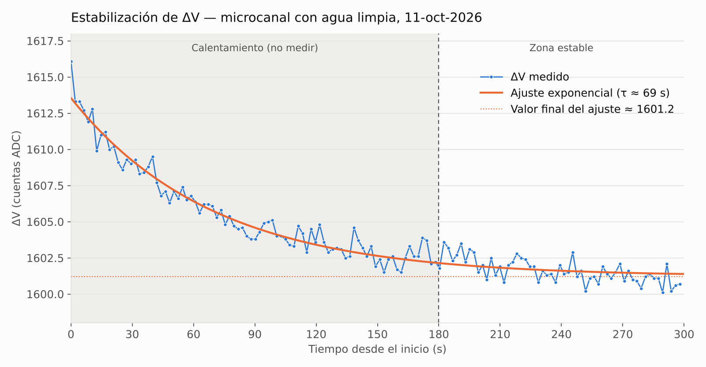

# Prueba de estabilidad temporal de la señal

**Fecha:** 11 de octubre de 2026
**Responsables:** Camila Pérez Mercado, Diego Alejandro Rodríguez Guzmán
**Proyecto:** Sistema microfluídico con instrumentación óptica para la detección preliminar de microplásticos tipo polietileno — Proyecto de Grado II, Universidad Santo Tomás

> **Resultado principal:** la señal útil (ΔV) disminuye de forma suave durante los primeros minutos después de encender el sistema y se estabiliza siguiendo una curva exponencial con constante de tiempo **τ ≈ 69 s**. A partir de los **3 minutos** la variación entre mediciones consecutivas es de apenas **~0.7 cuentas (0.04 %)**. Se define un **tiempo de calentamiento obligatorio de 3 minutos** antes de cualquier medición.

---

## 1. Objetivo

Determinar cuánto tiempo necesita el sistema para que la señal se estabilice después de cargar la muestra y encender el LED, y cuantificar la deriva y el ruido de la medición con una muestra patrón (agua limpia).

Esta prueba corresponde al parámetro de desempeño **"Estabilidad de señal"** del protocolo de validación del anteproyecto (sección 7.5.3, literal a) y aporta evidencia al **objetivo específico 3** (obtener una señal estable y representativa de la interacción óptica con la muestra).

## 2. Montaje y condiciones

| Elemento | Detalle |
|---|---|
| Microcontrolador | Raspberry Pi Pico 2 W (RP2350) |
| Firmware base | MicroPython v1.29.0 (2026-08-24) |
| Versión del firmware del proyecto | 0.1.0 (`adq.py` + `stats.py`, commit `e487d39`) |
| Fotodetector | OPT101, alimentado a 3.3 V desde la Pico, R<sub>f</sub> interna de 1 MΩ |
| Conexión al ADC | Salida del OPT101 directa a GP26 (ADC0), sin divisor |
| Emisor | LED infrarrojo controlado por GP15 mediante transistor 2N2222 |
| Resistencia del LED | 470 ohm |
| Muestra | Microcanal lleno con agua limpia, cámara de medición cerrada |
| Muestras por bloque (N) | 1000 |
| Frecuencia de muestreo (Fs) | 1000 Hz (medida: 1000.0 Hz, 0 muestras atrasadas) |
| Duración de la prueba | 300 s (5 minutos) |
| Número de mediciones | 143, una cada ~2.1 s |

## 3. Procedimiento

1. Se vació y se volvió a llenar el microcanal con agua limpia.
2. Se cerró la cámara de medición.
3. Se ejecutó inmediatamente el programa `prueba_estabilidad.py` en la Pico (ver anexo A).
4. No se tocó el montaje durante los 5 minutos de la prueba.

Cada una de las 143 mediciones sigue esta secuencia:

1. LED apagado → espera de 20 ms → bloque **dark** de 1000 muestras (1 s).
2. LED encendido → espera de 20 ms → bloque **light** de 1000 muestras (1 s).
3. LED apagado.
4. Cálculo de la media y la desviación estándar de cada bloque con el algoritmo de Welford.

## 4. Significado de cada variable

Todas las magnitudes están en **cuentas del ADC**. El ADC de la Pico es de 12 bits: convierte voltajes de 0 a 3.3 V en números enteros de 0 a 4095. Una cuenta equivale a 3.3 / 4096 ≈ **0.806 mV**.

$$V = \text{cuentas} \times \frac{3.3}{4096}$$

| Variable | Unidad | Qué representa |
|---|---|---|
| `t_s` | segundos | Tiempo transcurrido desde el inicio de la prueba hasta el comienzo de esa medición. |
| `mu_dark` | cuentas | **Media del bloque con el LED apagado** (1000 muestras). Es la señal de fondo: el voltaje de reposo del OPT101, más cualquier luz que se cuele en la cámara, más el offset del ADC. |
| `mu_light` | cuentas | **Media del bloque con el LED encendido** (1000 muestras). Es la luz del LED que atravesó el microcanal y el agua, sumada a la señal de fondo. |
| `dV` | cuentas | **ΔV = `mu_light` − `mu_dark`**. Es la señal útil del sistema: solo la parte de la señal producida por el LED, sin el fondo. Es la magnitud física con la que se compararán las muestras. |
| `sigma_light` | cuentas | **Desviación estándar de las 1000 muestras del bloque light.** Indica cuánto varía cada muestra individual alrededor de la media, es decir, el ruido de una sola lectura. |

**Aclaración importante sobre `sigma_light`:** no es la incertidumbre de la media. Al promediar N = 1000 muestras, la incertidumbre de la media se reduce a σ/√N ≈ 17.4 / √1000 ≈ **0.55 cuentas**. Por eso el sistema puede detectar cambios mucho más pequeños que el ruido de una lectura individual.

## 5. Resultados

### 5.1 Evolución de ΔV en el tiempo



### 5.2 Resumen de las 143 mediciones

| Variable | Inicio | Final | Media | Desv. estándar | Mínimo | Máximo |
|---|---:|---:|---:|---:|---:|---:|
| `mu_dark` | 23.6 | 23.9 | 23.86 | 0.16 | 23.4 | 24.3 |
| `mu_light` | 1639.7 | 1624.6 | 1627.93 | 3.24 | 1623.8 | 1639.7 |
| `dV` | 1616.1 | 1600.7 | 1604.08 | 3.24 | 1600.1 | 1616.1 |
| `sigma_light` | 17.5 | 17.4 | 17.40 | 0.39 | 16.3 | 18.3 |

En voltios: el fondo (`mu_dark`) es de unos **19 mV** y la señal útil final (`dV`) de unos **1.29 V**.

### 5.3 Comportamiento por minuto

| Intervalo | Mediciones | ΔV medio | Variación entre mediciones (desv. estándar) | Pendiente |
|---|---:|---:|---:|---:|
| 0 – 60 s | 29 | 1609.5 | 2.47 cuentas | −7.70 cuentas/min |
| 60 – 120 s | 29 | 1604.7 | 0.94 cuentas | −2.52 cuentas/min |
| 120 – 180 s | 28 | 1602.9 | 0.83 cuentas | −1.13 cuentas/min |
| 180 – 240 s | 29 | 1602.1 | 0.78 cuentas | −1.48 cuentas/min |
| 240 – 300 s | 28 | 1601.2 | 0.63 cuentas | −0.85 cuentas/min |

### 5.4 Ajuste exponencial

Los datos de ΔV se ajustaron al modelo:

$$\Delta V(t) = C + A \, e^{-t/\tau}$$

| Parámetro | Valor | Significado |
|---|---|---|
| C | 1601.22 ± 0.14 cuentas | Valor final al que tiende la señal |
| A | 12.3 ± 0.2 cuentas | Exceso inicial sobre el valor final |
| τ | 69.3 ± 3.3 s | Constante de tiempo de la estabilización |
| Residuo (desv. estándar) | 0.71 cuentas | Dispersión de los datos respecto a la curva |

Según el ajuste, la señal queda a menos de **2 cuentas** del valor final a los **~126 s** y a menos de **1 cuenta** a los **~174 s**.

## 6. Análisis

**La señal de fondo es estable.** `mu_dark` se mantuvo en 23.9 ± 0.2 cuentas durante toda la prueba. El ADC y el OPT101 no presentan deriva apreciable; todo el cambio observado proviene de la luz.

**La deriva es suave y decreciente.** ΔV cae 15.4 cuentas (0.95 %) en 5 minutos, siguiendo casi exactamente una curva exponencial: el residuo del ajuste (0.71 cuentas) es del mismo orden que la incertidumbre esperada de la media (0.55 cuentas). No se observan saltos ni fluctuaciones irregulares.

**Causa más probable: calentamiento del LED.** La potencia óptica de un LED disminuye a medida que aumenta la temperatura de su unión, hasta que alcanza el equilibrio térmico. Una deriva suave y decreciente con la señal de fondo constante es consistente con este fenómeno. Una deriva causada por el asentamiento del agua (movimiento, burbujas) se vería más irregular.

**El ruido de cada lectura no cambia con el tiempo.** `sigma_light` se mantuvo en 17.4 ± 0.4 cuentas durante toda la prueba: es una característica estable del sistema, no un efecto del calentamiento.

**Por qué es necesaria la espera.** Una vez estable, las mediciones consecutivas varían ~0.7 cuentas, lo que permitiría detectar cambios de 2 a 3 cuentas. Pero durante el primer minuto la señal se desplaza ~8 cuentas por sí sola. Si se comparan dos muestras medidas en momentos distintos del calentamiento, la deriva podría interpretarse falsamente como una diferencia entre ellas.

**Observación adicional.** El nivel de `mu_light` medido con la Pico (~1.31 V) es menor que el medido previamente con el multímetro (1.425 V). La causa más probable es un pequeño desplazamiento del LED o del sensor al realizar la conexión final al microcontrolador, lo que confirma la importancia de una sujeción mecánica firme.

## 7. Conclusiones y decisiones

1. **Se establece un tiempo de calentamiento de 3 minutos** después de cargar la muestra y encender el sistema, antes de iniciar cualquier medición.
2. Tras el calentamiento, la repetibilidad entre mediciones consecutivas es de **~0.7 cuentas (0.04 % de la señal)**.
3. La señal de fondo y el ruido por lectura son estables; la única fuente de deriva identificada está en la emisión de luz.

**Cambios derivados para el firmware:**

- Agregar la constante `WARMUP_S = 180` en `config.py`.
- Implementar un modo monitor que muestre ΔV en tiempo real para verificar la estabilización.
- Agregar al registro CSV la incertidumbre de la media (σ/√N), con nombres de columna que la distingan de la dispersión por muestra.
- Agregar un umbral de saturación propio del OPT101 (~2.52 V ≈ 3128 cuentas), ya que el sensor satura antes que el ADC.

**Recomendación para el protocolo experimental:** alternar el orden de las muestras (agua limpia, muestra con partículas, agua limpia...) para que cualquier deriva residual no favorezca a un grupo.

## 8. Limitaciones y pruebas pendientes

- Se trata de una sola corrida. Conviene repetirla al menos dos veces para confirmar τ y el tiempo de calentamiento.
- La causa (LED frente a la temperatura del agua) no está demostrada. Prueba de confirmación propuesta: dejar el LED encendido 5 minutos para que se caliente, luego recargar el microcanal y medir. Si la señal no deriva, la causa era el LED.
- La resistencia definitiva del LED está pendiente de documentar.

## 9. Archivos relacionados

| Archivo | Contenido |
|---|---|
| `estabilidad_2026-10-11.csv` | Datos crudos de las 143 mediciones |
| `estabilidad_2026-10-11.png` | Gráfica de la sección 5.1 |
| `firmware/adq.py` | Capa de adquisición utilizada |
| `firmware/stats.py` | Funciones estadísticas utilizadas |

---

## Anexo A. Programa utilizado

```python
from firmware.adq import Acquisition
from firmware import stats
import time

DURACION_S = 300  # 5 minutos

acq = Acquisition()
t0 = time.ticks_ms()

print("t_s,mu_dark,mu_light,dV,sigma_light")
while True:
    t = time.ticks_diff(time.ticks_ms(), t0) / 1000
    if t > DURACION_S:
        break
    dark, light = acq.measure_repetition()
    s_d = stats.welford_block(dark)
    s_l = stats.welford_block(light)
    dv = s_l["mu"] - s_d["mu"]
    print("{:.1f},{:.1f},{:.1f},{:.1f},{:.1f}".format(
        t, s_d["mu"], s_l["mu"], dv, s_l["sigma"]))

acq.shutdown()
print("fin")
```

## Anexo B. Tabla completa de mediciones

<details>
<summary>Ver las 143 mediciones</summary>

| # | t_s | mu_dark | mu_light | dV | sigma_light |
|---:|---:|---:|---:|---:|---:|
| 1 | 0.0 | 23.6 | 1639.7 | 1616.1 | 17.5 |
| 2 | 2.1 | 23.7 | 1637.0 | 1613.3 | 17.6 |
| 3 | 4.2 | 23.8 | 1637.1 | 1613.3 | 17.2 |
| 4 | 6.3 | 23.5 | 1636.2 | 1612.7 | 17.2 |
| 5 | 8.4 | 23.7 | 1635.6 | 1611.9 | 17.4 |
| 6 | 10.5 | 23.6 | 1636.4 | 1612.8 | 16.6 |
| 7 | 12.6 | 23.4 | 1633.2 | 1609.9 | 18.1 |
| 8 | 14.7 | 23.8 | 1634.8 | 1611.0 | 17.8 |
| 9 | 16.8 | 23.7 | 1634.9 | 1611.2 | 17.6 |
| 10 | 18.9 | 23.7 | 1633.7 | 1610.0 | 17.6 |
| 11 | 21.0 | 23.7 | 1634.0 | 1610.2 | 17.7 |
| 12 | 23.1 | 23.8 | 1632.8 | 1609.1 | 17.8 |
| 13 | 25.2 | 23.6 | 1632.2 | 1608.6 | 18.1 |
| 14 | 27.3 | 24.1 | 1633.4 | 1609.3 | 17.4 |
| 15 | 29.4 | 24.0 | 1633.0 | 1609.0 | 17.2 |
| 16 | 31.5 | 24.0 | 1633.2 | 1609.3 | 17.2 |
| 17 | 33.6 | 23.9 | 1632.2 | 1608.3 | 17.6 |
| 18 | 35.7 | 23.9 | 1632.3 | 1608.4 | 17.4 |
| 19 | 37.8 | 24.0 | 1632.8 | 1608.8 | 16.8 |
| 20 | 39.9 | 24.0 | 1633.4 | 1609.5 | 16.6 |
| 21 | 42.0 | 23.9 | 1631.6 | 1607.7 | 17.0 |
| 22 | 44.1 | 24.1 | 1630.9 | 1606.8 | 17.5 |
| 23 | 46.2 | 23.8 | 1630.9 | 1607.1 | 17.5 |
| 24 | 48.3 | 23.8 | 1630.2 | 1606.3 | 18.0 |
| 25 | 50.4 | 23.9 | 1631.0 | 1607.1 | 17.1 |
| 26 | 52.5 | 23.9 | 1630.5 | 1606.6 | 17.8 |
| 27 | 54.6 | 23.9 | 1631.3 | 1607.4 | 17.4 |
| 28 | 56.6 | 24.0 | 1630.5 | 1606.5 | 17.1 |
| 29 | 58.7 | 23.9 | 1630.7 | 1606.8 | 17.0 |
| 30 | 60.8 | 23.9 | 1630.3 | 1606.4 | 17.9 |
| 31 | 62.9 | 24.0 | 1629.6 | 1605.6 | 17.6 |
| 32 | 65.0 | 24.0 | 1630.2 | 1606.2 | 17.3 |
| 33 | 67.1 | 24.0 | 1630.2 | 1606.2 | 17.4 |
| 34 | 69.2 | 24.1 | 1630.2 | 1606.1 | 17.2 |
| 35 | 71.3 | 23.9 | 1629.2 | 1605.3 | 17.7 |
| 36 | 73.4 | 24.1 | 1629.9 | 1605.8 | 17.0 |
| 37 | 75.5 | 24.1 | 1628.9 | 1604.8 | 18.2 |
| 38 | 77.6 | 23.9 | 1629.3 | 1605.4 | 17.3 |
| 39 | 79.7 | 23.8 | 1628.5 | 1604.7 | 17.7 |
| 40 | 81.8 | 24.1 | 1628.6 | 1604.5 | 17.4 |
| 41 | 83.9 | 23.9 | 1628.5 | 1604.6 | 17.2 |
| 42 | 86.0 | 23.9 | 1627.9 | 1604.0 | 17.4 |
| 43 | 88.1 | 23.9 | 1627.7 | 1603.8 | 17.8 |
| 44 | 90.2 | 24.1 | 1627.9 | 1603.8 | 17.3 |
| 45 | 92.3 | 24.0 | 1628.3 | 1604.3 | 17.6 |
| 46 | 94.4 | 23.9 | 1628.9 | 1604.9 | 17.3 |
| 47 | 96.5 | 23.9 | 1628.9 | 1605.0 | 17.5 |
| 48 | 98.6 | 24.0 | 1629.2 | 1605.1 | 17.2 |
| 49 | 100.7 | 23.9 | 1627.9 | 1604.0 | 17.2 |
| 50 | 102.8 | 24.1 | 1628.1 | 1604.0 | 17.4 |
| 51 | 104.9 | 23.9 | 1627.7 | 1603.8 | 17.5 |
| 52 | 107.0 | 23.8 | 1627.3 | 1603.4 | 17.5 |
| 53 | 109.1 | 24.1 | 1627.4 | 1603.3 | 17.6 |
| 54 | 111.2 | 24.1 | 1628.7 | 1604.7 | 16.7 |
| 55 | 113.3 | 23.8 | 1628.0 | 1604.2 | 17.4 |
| 56 | 115.4 | 24.0 | 1626.9 | 1602.9 | 17.4 |
| 57 | 117.5 | 23.8 | 1628.3 | 1604.5 | 16.9 |
| 58 | 119.6 | 24.2 | 1627.8 | 1603.6 | 17.3 |
| 59 | 121.7 | 24.0 | 1628.8 | 1604.8 | 16.5 |
| 60 | 123.8 | 24.3 | 1627.9 | 1603.6 | 17.1 |
| 61 | 125.9 | 24.0 | 1626.9 | 1602.9 | 17.9 |
| 62 | 128.0 | 24.1 | 1627.2 | 1603.1 | 17.3 |
| 63 | 130.1 | 24.0 | 1627.2 | 1603.2 | 17.7 |
| 64 | 132.2 | 24.0 | 1627.1 | 1603.1 | 17.2 |
| 65 | 134.3 | 24.0 | 1626.4 | 1602.5 | 17.5 |
| 66 | 136.4 | 24.1 | 1626.7 | 1602.6 | 17.8 |
| 67 | 138.5 | 23.9 | 1628.5 | 1604.6 | 16.9 |
| 68 | 140.6 | 23.8 | 1627.5 | 1603.7 | 17.2 |
| 69 | 142.7 | 24.0 | 1627.2 | 1603.2 | 17.2 |
| 70 | 144.8 | 23.8 | 1626.4 | 1602.6 | 17.8 |
| 71 | 146.9 | 24.0 | 1627.3 | 1603.3 | 17.3 |
| 72 | 149.0 | 23.8 | 1625.7 | 1601.9 | 17.2 |
| 73 | 151.1 | 24.1 | 1626.5 | 1602.4 | 17.8 |
| 74 | 153.2 | 24.1 | 1625.6 | 1601.5 | 17.7 |
| 75 | 155.3 | 24.0 | 1626.4 | 1602.4 | 17.5 |
| 76 | 157.4 | 24.0 | 1626.6 | 1602.6 | 17.2 |
| 77 | 159.5 | 23.9 | 1625.6 | 1601.7 | 18.0 |
| 78 | 161.6 | 24.1 | 1625.6 | 1601.5 | 17.7 |
| 79 | 163.6 | 24.0 | 1626.4 | 1602.5 | 16.8 |
| 80 | 165.7 | 23.9 | 1627.2 | 1603.3 | 17.4 |
| 81 | 167.8 | 23.8 | 1626.3 | 1602.6 | 17.3 |
| 82 | 169.9 | 24.0 | 1626.5 | 1602.6 | 17.2 |
| 83 | 172.0 | 23.9 | 1627.8 | 1603.9 | 16.5 |
| 84 | 174.1 | 23.9 | 1627.6 | 1603.7 | 17.0 |
| 85 | 176.2 | 23.6 | 1625.8 | 1602.1 | 17.8 |
| 86 | 178.3 | 23.7 | 1625.9 | 1602.2 | 17.1 |
| 87 | 180.4 | 23.8 | 1625.6 | 1601.8 | 18.3 |
| 88 | 182.5 | 23.9 | 1627.5 | 1603.6 | 16.8 |
| 89 | 184.6 | 23.7 | 1626.9 | 1603.2 | 17.0 |
| 90 | 186.7 | 23.9 | 1626.2 | 1602.3 | 17.5 |
| 91 | 188.8 | 23.9 | 1626.6 | 1602.7 | 17.3 |
| 92 | 190.9 | 23.8 | 1627.3 | 1603.5 | 16.6 |
| 93 | 193.0 | 23.9 | 1626.1 | 1602.2 | 17.2 |
| 94 | 195.1 | 23.9 | 1626.9 | 1603.1 | 16.7 |
| 95 | 197.2 | 23.7 | 1626.6 | 1602.9 | 16.8 |
| 96 | 199.3 | 23.8 | 1625.3 | 1601.5 | 18.1 |
| 97 | 201.4 | 24.0 | 1626.1 | 1602.0 | 18.0 |
| 98 | 203.5 | 24.0 | 1625.0 | 1601.0 | 17.7 |
| 99 | 205.6 | 23.8 | 1626.2 | 1602.5 | 17.4 |
| 100 | 207.7 | 23.8 | 1625.1 | 1601.3 | 17.5 |
| 101 | 209.8 | 23.9 | 1625.8 | 1601.9 | 17.5 |
| 102 | 211.9 | 23.7 | 1624.5 | 1600.8 | 17.9 |
| 103 | 214.0 | 23.8 | 1625.8 | 1602.0 | 17.4 |
| 104 | 216.1 | 23.7 | 1625.9 | 1602.2 | 17.5 |
| 105 | 218.2 | 23.7 | 1626.5 | 1602.8 | 16.8 |
| 106 | 220.3 | 23.7 | 1626.2 | 1602.5 | 17.1 |
| 107 | 222.4 | 23.8 | 1626.2 | 1602.4 | 17.2 |
| 108 | 224.5 | 23.8 | 1625.7 | 1601.9 | 17.2 |
| 109 | 226.6 | 23.5 | 1625.4 | 1601.9 | 17.8 |
| 110 | 228.7 | 23.7 | 1624.5 | 1600.8 | 17.6 |
| 111 | 230.8 | 23.7 | 1625.3 | 1601.6 | 17.1 |
| 112 | 232.9 | 23.7 | 1625.0 | 1601.3 | 17.8 |
| 113 | 235.0 | 23.7 | 1625.2 | 1601.4 | 17.7 |
| 114 | 237.1 | 23.8 | 1624.5 | 1600.8 | 17.7 |
| 115 | 239.2 | 24.0 | 1626.0 | 1602.0 | 17.0 |
| 116 | 241.3 | 23.7 | 1625.0 | 1601.4 | 17.6 |
| 117 | 243.4 | 23.8 | 1625.4 | 1601.5 | 17.4 |
| 118 | 245.5 | 23.6 | 1626.5 | 1602.9 | 16.3 |
| 119 | 247.6 | 23.7 | 1624.9 | 1601.2 | 18.0 |
| 120 | 249.7 | 23.5 | 1625.2 | 1601.6 | 17.5 |
| 121 | 251.8 | 23.8 | 1624.0 | 1600.2 | 18.1 |
| 122 | 253.9 | 23.8 | 1624.9 | 1601.1 | 17.9 |
| 123 | 256.0 | 23.4 | 1624.6 | 1601.2 | 17.3 |
| 124 | 258.1 | 23.7 | 1624.4 | 1600.7 | 17.9 |
| 125 | 260.2 | 23.7 | 1625.6 | 1601.9 | 17.0 |
| 126 | 262.3 | 23.8 | 1625.1 | 1601.4 | 17.4 |
| 127 | 264.4 | 23.9 | 1625.0 | 1601.1 | 17.2 |
| 128 | 266.5 | 24.0 | 1625.5 | 1601.5 | 17.1 |
| 129 | 268.6 | 23.8 | 1625.9 | 1602.1 | 17.3 |
| 130 | 270.7 | 23.8 | 1624.7 | 1600.9 | 17.7 |
| 131 | 272.8 | 23.7 | 1625.2 | 1601.6 | 17.4 |
| 132 | 274.9 | 23.6 | 1624.6 | 1601.0 | 17.5 |
| 133 | 276.9 | 23.6 | 1624.5 | 1600.9 | 18.2 |
| 134 | 279.0 | 23.8 | 1624.2 | 1600.4 | 17.9 |
| 135 | 281.1 | 23.7 | 1624.8 | 1601.2 | 16.9 |
| 136 | 283.2 | 23.8 | 1625.1 | 1601.4 | 17.6 |
| 137 | 285.3 | 23.8 | 1624.9 | 1601.1 | 17.4 |
| 138 | 287.4 | 23.8 | 1624.9 | 1601.1 | 17.0 |
| 139 | 289.5 | 23.7 | 1623.8 | 1600.1 | 17.7 |
| 140 | 291.6 | 23.5 | 1625.6 | 1602.1 | 17.0 |
| 141 | 293.7 | 23.9 | 1624.1 | 1600.2 | 17.8 |
| 142 | 295.8 | 23.9 | 1624.5 | 1600.6 | 17.5 |
| 143 | 297.9 | 23.9 | 1624.6 | 1600.7 | 17.4 |

</details>
